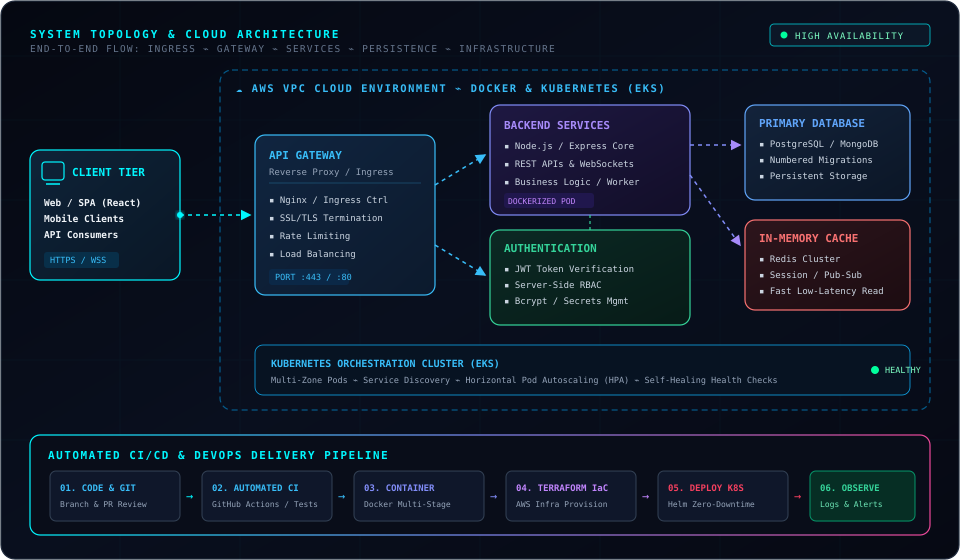
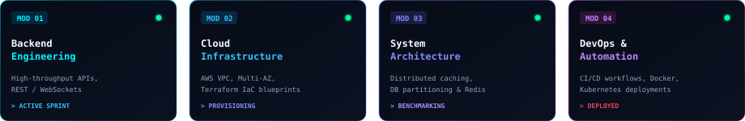

 

  

⌁&nbsp;&nbsp;&nbsp;&nbsp;|&nbsp;&nbsp;&nbsp;&nbsp;|&nbsp;&nbsp;&nbsp;&nbsp;|&nbsp;&nbsp;

 

## `01` ⌁ Tech Stack

<table>
<tr>
<td width="50%" valign="top">

#### ⚡ Backend &amp; APIs

</td>
<td width="50%" valign="top">

#### 🗄️ Database &amp; Storage

</td>
</tr>
<tr>
<td width="50%" valign="top">

#### ☁️ Cloud &amp; DevOps

</td>
<td width="50%" valign="top">

#### 🛠️ Infrastructure &amp; Systems

</td>
</tr>
<tr>
<td colspan="2" valign="top">

#### 🎨 Frontend &amp; UI

</td>
</tr>
</table>

 

## `02` ⌁ Engineering Architecture

 

## `03` ⌁ Featured Projects

<table>
<tr>
<td width="50%" valign="top">

### 🛒 SolivaGuard
**Production E-Commerce Platform**
> Production e-commerce platform with secure auth, payment gateway, order management, and automated containerized CI/CD.

`React` · `Node.js` · `Express` · `MongoDB` · `Docker` · `AWS` · `Nginx`

[🔗 Live Demo](https://solivaguard.com) &nbsp;·&nbsp; [📦 GitHub](https://github.com/adi-Git-Hub)

</td>
<td width="50%" valign="top">

### ⚡ Kinetic Care Gym
**Client Landing Page**
> Responsive client landing page engineered with fluid animations, dynamic interactions, and high-conversion UI.

`React` · `TypeScript` · `Vite` · `Tailwind CSS` · `Framer Motion`

[🔗 Live Demo](https://adi-git-hub.github.io/kinetic_care_gym-mobile-app/) &nbsp;·&nbsp; [📦 Repository](https://github.com/adi-Git-Hub/kinetic_care_gym-mobile-app)

</td>
</tr>
<tr>
<td width="50%" valign="top">

### 🍰 Jainism Cake &amp; Café
**Client Website &amp; Smart Ordering**
> Real-time table QR ordering platform with live kitchen tracking over WebSockets, role-based staff portals, and shared contracts.

`React 19` · `TypeScript` · `Express` · `Socket.IO` · `SQLite`

[📦 Repository](https://github.com/adi-Git-Hub/QR-Menu-System-jainism-cake-cafe)

</td>
<td width="50%" valign="top">

### ☸️ Multi-Tier Kubernetes Deployment
**Microservices Cloud Infrastructure**
> Production-style multi-tier microservices on Kubernetes with automated Helm charts, CI/CD pipelines, and rolling updates.

`Kubernetes` · `Docker` · `Helm` · `Jenkins` · `AWS` · `GitHub Actions`

[📦 GitHub Showcase](https://github.com/adi-Git-Hub/)

</td>
</tr>
<tr>
<td colspan="2" valign="top">

### 🚗 Interactive 3D Shopping Experience
**CloudCar Platform**
> Immersive 3D e-commerce automotive showroom with interactive 3D rendering, JWT security, and automated database migrations.

`React` · `Three.js` · `React Three Fiber` · `Node.js` · `Express` · `PostgreSQL`

[🔗 Live Demo](https://3d-e-commarce-new-update.vercel.app) &nbsp;·&nbsp; [📦 Repository](https://github.com/adi-Git-Hub/Cloud-Native-Full-stack-DevOps-Intregated-E-Car_Website)

</td>
</tr>
</table>

 

## `04` ⌁ GitHub Analytics

 

 

## `05` ⌁ Currently Building

 

  

⌁&nbsp;&nbsp;&nbsp;&nbsp;|&nbsp;&nbsp;&nbsp;&nbsp;|&nbsp;&nbsp;&nbsp;&nbsp;|&nbsp;&nbsp;

